# AtlanteanConstructor: cut-and-fill simulator for ring moats and berms

AtlanteanConstructor simulates building a concentric "Atlantean" site: rings of
moats, with the spoil from each moat built into the berm beside it. It models
two ways to do the work:

- a **centre-pivot rig**: a radial truss over a 410 m site, with a scraper
  carriage, a conveyor and a discharge chute;
- a **tethered eOx trencher**: an electric tractor from the sibling
  [eOx](https://github.com/zacharyelston/EOx) project, on a leash from a
  central pivot, cutting a garden-scale site about 100 m across.

All the code is plain Python and NumPy in [`ring_engine/`](ring_engine/). Blender
4.x/5.x is optional and only animates the pivot rig.

| Pivot rig, lift 5 of 8 | Pivot rig, finished |
|---|---|
| 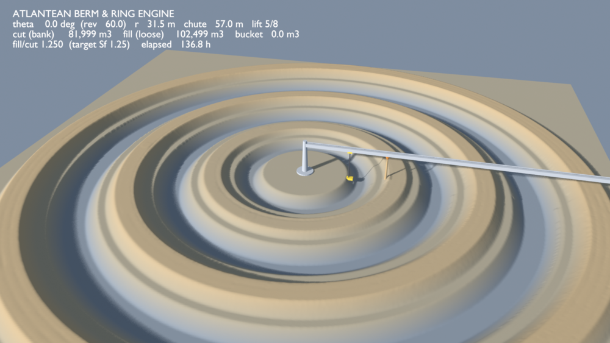 | 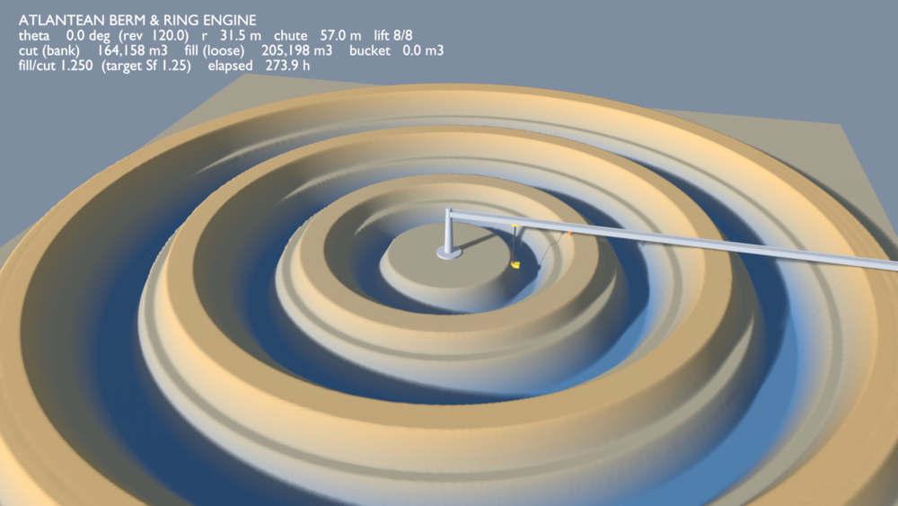 |

*Blender renders of `simulation_runner.py`, frames 150 and 300, relief
exaggerated 3×. The HUD shows bank cut, loose fill and their ratio, which
holds at the swell factor (Sf = 1.25) all the way through.*

| New England till, 6 ft slope | Florida sand, flat lot |
|---|---|
| 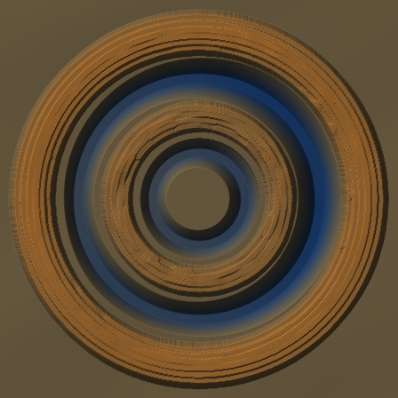 | 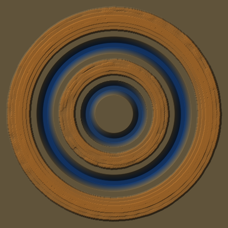 |

*The same garden-scale site cut by the tethered 6WD eOx trencher
(`tether_sim.py`). Blue is cut below existing ground and orange is fill.
Results are under
[Results](#results-tractor-loader-backhoes-vs-eox-trenchers).*

---

## The homestead

The goal is a home farm: three domes on a raised island around a courtyard,
a shallow inner ring, an orchard berm, an 8 ft deep ring for fish and the
ground loop, and a pasture berm. Solar panels stand on the north border. See
[docs/simple-build.md](docs/simple-build.md), [docs/energy.md](docs/energy.md)
and [docs/economics.md](docs/economics.md).

| New England, 6 ft slope | The island, courtyard and floating spoke |
|---|---|
| 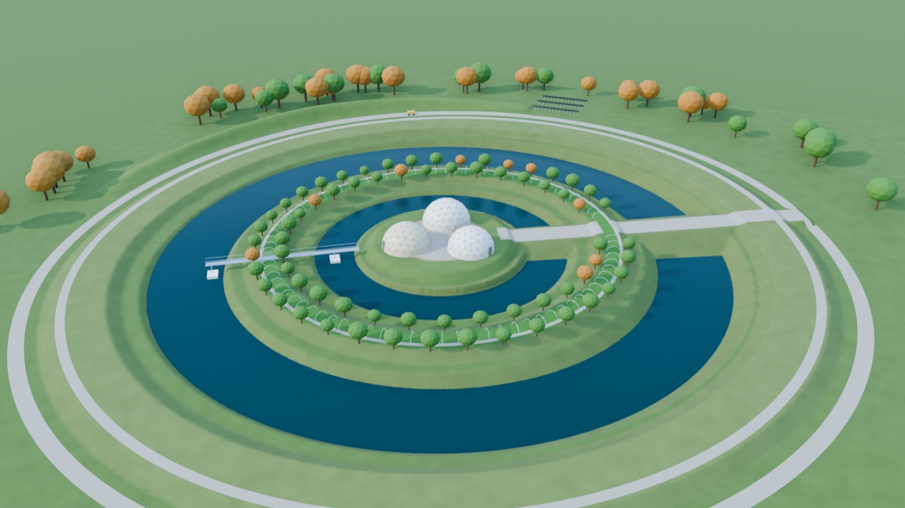 | 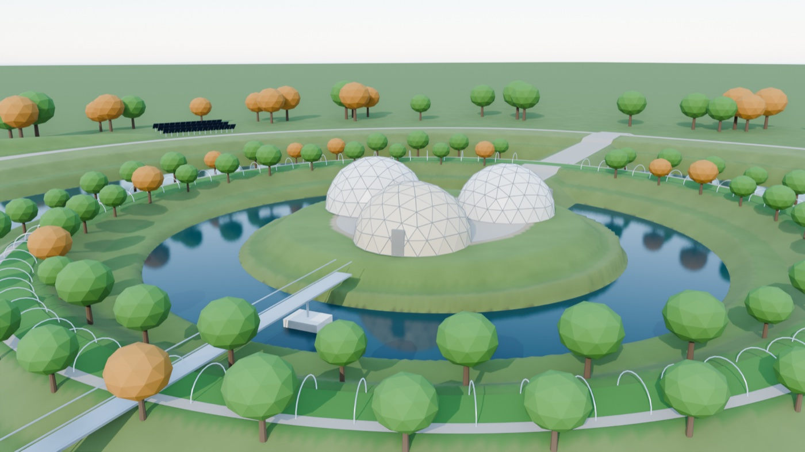 |

| Plan view | Florida, flat lot |
|---|---|
| 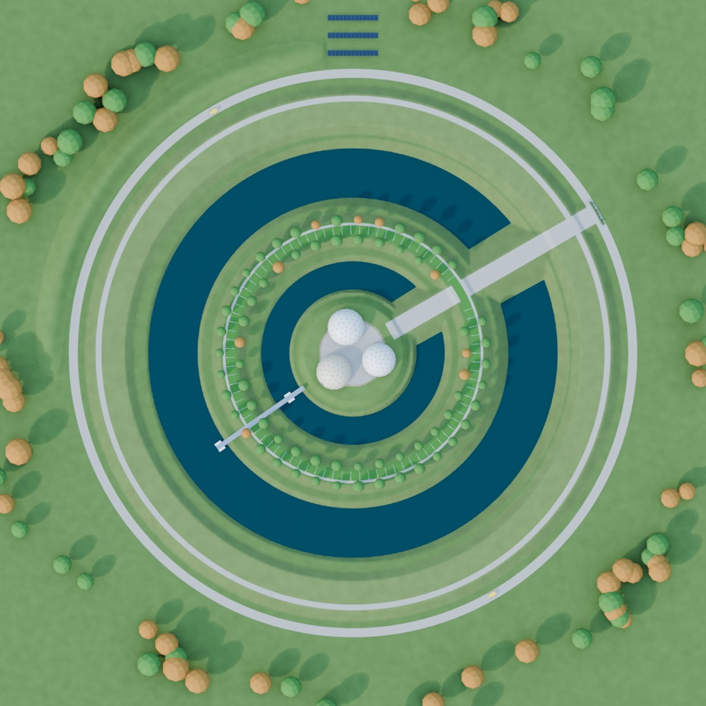 | 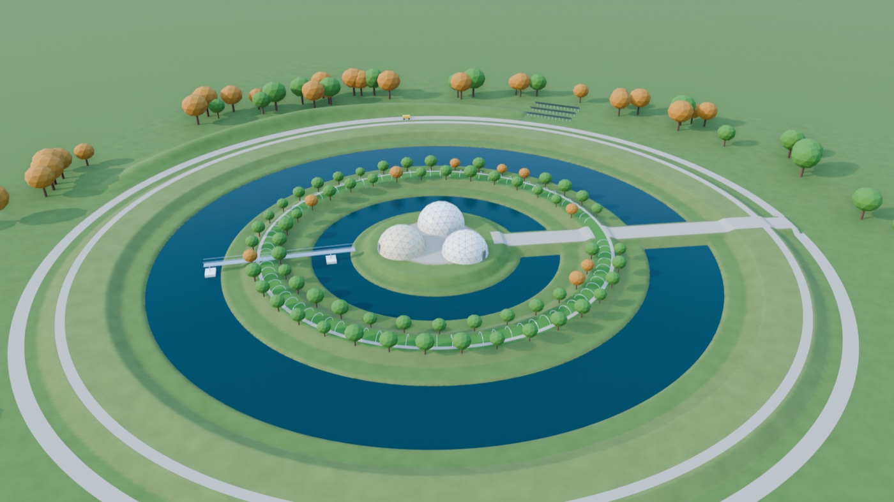 |

*Blender renders made by `tools/render_homestead.py` from
`ring_engine/homestead_params.json`, with the relief exaggerated 1.5×. The
ground, rings, berms and waterlines are the designed terrain. The domes,
hoops, trees, spoke, eOx and panels are stand-ins placed by the rules in the
docs.*

---

## Two rigs, one terrain engine

| | Pivot rig | Tethered eOx trencher |
|---|---|---|
| Site | 3 moats, 3 berms, 410 m across | 2 moats, 2 berms, about 105 m across |
| Machine | 211 m radial truss on a 22 m mast; scraper carriage, conveyor, chute | eOx built from eOx drive-axle modules, towing a box scraper |
| Soil moved | 164,000 m³ bank cut | 2,200–3,900 m³ bank cut |
| Ground | Flat | Flat, or sloped 6 ft with moats cut to a level waterline |
| Limited by | Kinematics and an assumed 600 m³/h production rate | Tyre grip, motor force, motor heat, rock, wet ground |
| Run | `simulation_runner.py`, headless or in Blender | `tether_sim.py`, `compare_sites.py` |

Both rigs share the terrain engine (`terrain_engine.py`):

- **Two layers per cell:** each cell of the heightmap stores *bank* (in-situ)
  soil and *loose* spoil on top of it.
- **Swell:** bank soil swells by Sf when it is cut. Loose spoil that is
  scraped up again does not swell a second time.
- **Exact mass balance:** `loose on ground + bucket = Sf × bank cut` holds at
  every step.
- **Berm sizing:** each berm's crown height is solved by bisection so that its
  volume is Sf × the volume of the moat that feeds it. Flanks are capped at the
  angle of repose.
- **Slumping:** a mass-conserving pass moves loose spoil only, and only where
  the slope is steeper than the angle of repose.

---

## Pivot rig

A radial truss turns on a centre pivot. A scraper carriage runs along it, and
a conveyor carries each cut to a chute over the paired berm.

- **Path:** an Archimedean spiral or stepped rings, in 8 lifts. Odd lifts run
  outward and even lifts run inward.
- **Mass-haul conveyor:** the chute sits at the berm radius whose cumulative
  design-fill fraction matches the cumulative cut fraction at the scraper. That
  keeps the bucket from stalling.
- **Cycle time:** each step takes `max(|Δθ|/v_θ, |Δr|/v_r, Δs/v_tool)`. The
  production-limited time also applies `production_rate_m3_hr`.
- **Display:** `animation.display_exaggeration` scales the relief in Blender
  only. Volumes always use true elevations.

| | Default run (`params.json`) |
|---|---|
| Moats | r 30–50 m (4 m deep), 80–105 m (5 m), 140–170 m (5 m) |
| Soil | Sf 1.25, repose 33°, canal side slope 30° |
| Bank cut / loose fill | 164,158 m³ / 205,198 m³, fill/cut **1.250** |
| Mass-balance error | about 1e-9 m³ |
| Moat completion | 99.8 %; profile RMSE 0.03 m (moats), 0.014 m (berms) |
| Time | 274 h at 600 m³/h (11.8 h of pure kinematics) |

---

## Tethered eOx trencher

<picture>
  <source media="(prefers-color-scheme: dark)" srcset="docs/img/tether-concept-dark.svg">
  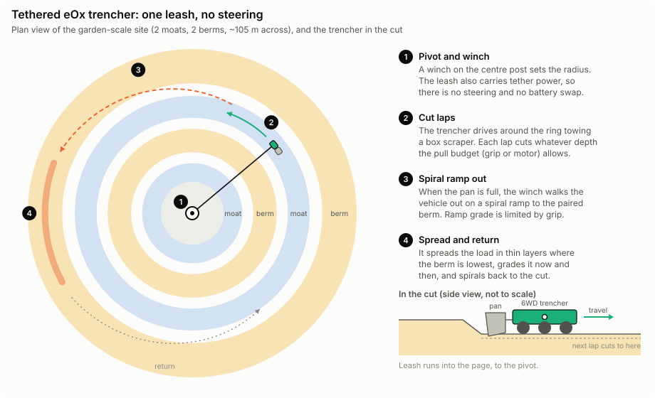
</picture>

An eOx on a leash tows a box scraper around and around a central pivot. The
winch sets the radius, so the vehicle never steers.

- **Cutting:** each lap cuts whatever the pull budget allows.
- **Hauling:** when the pan is full, the winch walks the vehicle out on a
  spiral ramp to the paired berm. It spreads the load in thin layers where the
  berm is lowest, then spirals back.
- **Physics per step:**
  - pull available = min(tyre grip, motor force), with grip from Brixius /
    ASAE D497 (`tyres.py`, ported from eOx);
  - pull needed = rolling + grade + cutting energy per metre;
  - speed = min(tool speed, shaft power / pull).
- **What slows it down:**
  - torque² motor heating, with cooling pauses;
  - boulder refusals;
  - wet ground below the water table;
  - grip-limited ramps;
  - periodic berm grading;
  - battery recharges, when not on tether power.

### Vehicles

Every trencher is built from eOx parts (`eox_vehicle.py`): N golf-cart
drive-axle modules, each with a 3 HP unit on the 48 V bus. Every axle is
driven, because the leash does the steering.

| Key | Vehicle | Mass | Rated / peak pull | Pan |
|---|---|---|---|---|
| `home_2wd` | eOx Home (tethered stand-in) | 237 kg | 360 / 1,451 N | |
| `t4_15` | 4WD, 15:1 | 272 kg | 725 / 2,902 N | 4 ft |
| `t4_25` | 4WD, 24.8:1 | 272 kg | 1,199 / 4,798 N | 5 ft |
| `t4_25_b250` | 4WD, 24.8:1, +250 kg ballast | 522 kg | 1,199 / 4,798 N | 5 ft |
| `t6_25` | 6WD, 24.8:1 | 366 kg | 1,799 / 7,197 N | 6 ft |
| `t6_25_b400` | 6WD, 24.8:1, +400 kg ballast | 766 kg | 1,799 / 7,197 N | 6 ft |
| `t6_25_fan` | 6WD, 24.8:1, fan-cooled motors | 366 kg | 2,519 / 7,197 N | 6 ft |
| `train_3x4wd` | Train: 3 × 4WD on one leash | 816 kg | 3,598 / 14,394 N | 3 × 5 ft |
| `train_2x6wd` | Train: 2 × 6WD on one leash | 731 kg | 3,598 / 14,394 N | 2 × 6 ft |

- **Gearing:** 24.8:1 is the stock golf-cart rear end plus a chain stage.
- **Bus:** three 3 HP units at rated power is the most one pack and contactor
  carry (197 A of 200 A). That is why 6WD is the largest single car, and why
  bigger machines are trains of cars, each with its own bus.
- **Fan cooling** is ASSUMED to give about 1.4× continuous torque at low speed.
  It needs a bench test.

The conventional baseline is three classes of tractor loader-backhoe (TLB),
with typical spec-sheet figures (`vehicles/conventional_machines.json`):
subcompact (~25 hp), compact (~45 hp) and backhoe loader (~90 hp).
`conventional.py` estimates them with handbook production formulas.

### Level water on a slope

<picture>
  <source media="(prefers-color-scheme: dark)" srcset="docs/img/level-water-dark.svg">
  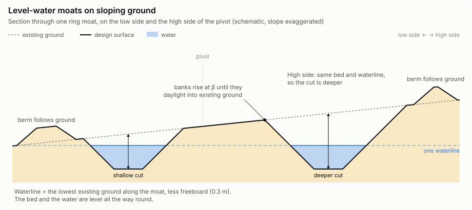
</picture>

A moat has to hold water, so on sloping ground it can't simply follow the
ground.

- **One waterline per moat:** the lowest existing ground along the moat, less
  0.3 m freeboard. The bed is flat at the design depth below it.
- **High side cut deeper:** on the 6 ft New England slope the outer moat is cut
  up to 2.76 m deep, against 1.5 m on the flat Florida lot.
- **Banks daylight:** they rise at the side-slope angle β until they meet
  existing ground.
- **Berms follow ground:** each berm sits on existing ground, and its crown is
  sized from the moat's volume.
- **Checked:** the design is checked so that no moat's banks reach into a
  berm's footprint.

### Scenarios

| Scenario | Ground | Soil (`soils.json`) | Design cut / loose fill |
|---|---|---|---|
| `ne_till` | 6 ft slope | New England glacial till: rocky clay loam, dense basal till, dry. Sf 1.40, 0.15 boulder refusals per m³ | 3,888 / 5,443 m³, deepest 2.76 m |
| `ne_till_wet` | 6 ft slope | The same till in a wet spring: perched water table at 0.5 m, sticky, low grip | 3,861 / 5,212 m³ |
| `florida_sand` | Flat | Florida fine sand: no rock, water table at 0.9 m, poor grip, high rolling resistance. Sf 1.12 | 2,156 / 2,415 m³, deepest 1.50 m |

| | Existing ground | Design | Half cut | Finished |
|---|---|---|---|---|
| **New England** |  |  | 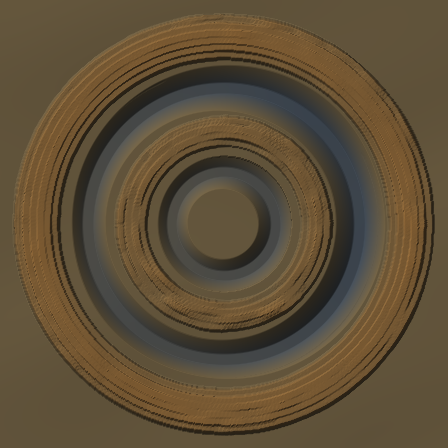 |  |
| **Florida** |  |  | 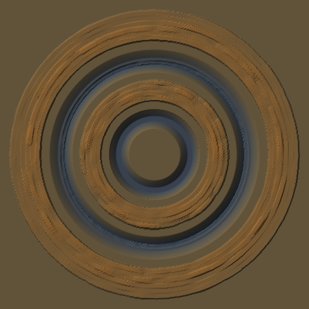 |  |

*Top-down hillshades from the 6WD 24.8:1 trencher runs (`runs/2026-11-04_compare_v1`), 56 m
from the pivot to each edge. Colour is cut (blue) or fill (orange) against
existing ground.*

<picture>
  <source media="(prefers-color-scheme: dark)" srcset="docs/img/section-ne-fl-dark.svg">
  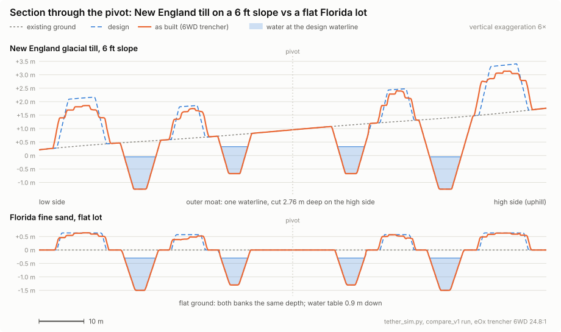
</picture>

- **Moats:** they come out on design: profile RMSE 0.016 m in New England and
  0.008 m in Florida.
- **Berms:** they come out wider and lower than designed (profile RMSE 0.36 m
  in New England, 0.12 m in Florida). The trencher spreads each load where the
  berm is lowest, and the extra width holds the same volume.

---

## Results: tractor loader-backhoes vs eOx trenchers

27 runs: 9 eOx vehicles × 3 scenarios, plus the TLB baseline for each scenario.
The full tables, with every column, are in
[`runs/2026-11-04_compare_v2/COMPARISON.md`](runs/2026-11-04_compare_v2/COMPARISON.md).

**These are screening estimates.** Soil values are handbook figures, not
test-pit data, and machine rates are assumed. Brixius is optimistic about grip
in loose sand. Compare the scenarios and machines with each other; don't read
any single number as a prediction.

**Days to build the site.** TLB days are 8 h operator days. eOx days are 10 h
of unattended running on the tether. The "fleet" figure is 4 identical
machines working at once: one per moat first, then sharing a moat at 85 %
efficiency each.

| Machine | NE till, 6 ft slope | NE till, wet spring | Florida sand |
|---|---|---|---|
| Subcompact TLB (~25 hp) | 615 | 623 | 175 |
| Compact TLB (~45 hp) | 242 | 247 | 72 |
| **Backhoe loader (~90 hp)** | **68** | **69** | **20** |
| Backhoe loader × 2 | 55 | 57 | 16 |
| eOx Home 2WD | 1,707 | 1,298 | 332 |
| eOx 4WD, 15:1 | 206 | 284 | 52 |
| eOx 4WD, 24.8:1 | 103 | 123 | 25 |
| eOx 6WD, 24.8:1 | 72 | 85 | 14 |
| eOx 6WD, 24.8:1, fan-cooled | 51 | 66 | 13 |
| **eOx train, 2 × 6WD** | **44** | **53** | **8** |
| eOx train, 2 × 6WD, fleet of 4 | 14 | 16 | 3 |

**Cost to build.**
- **TLB:** rental with operator, plus fuel, delivery and a pump. In New
  England: backhoe loader **$102k** ($26/m³), compact $253k, subcompact $481k.
  In Florida: $31k, $76k and $140k.
- **eOx:** running cost only, electricity at $0.25/kWh plus $40/h of labour
  to clear boulders and stalls: about **$5k** in New England and $0.2–0.6k in
  Florida. That figure excludes buying or building the machine, and anyone
  supervising it.

What the runs show:

- **New England is 5× harder than Florida for the same machine.** Its design
  cut is 3,888 m³, against 2,156 m³ in Florida. The 6 ft slope makes the
  high-side moat 2.8 m deep to hold level water. Till also swells 1.40× where
  sand swells 1.12×, takes about 5× the energy to cut, and turns up about 550
  boulders.
- **Of the TLBs, the backhoe loader is the sweet spot.** Its bucket grows
  faster than its hourly rate, so it is 3.5× faster and 2.5× cheaper than the
  compact TLB. The subcompact's 1.8 m dig depth can't reach the 2.76 m
  high-side cut (366 m³ has to be dug from a bench in the moat), and it is
  never the sensible choice.
- **The Home 2WD isn't a trencher.** Its 360 N continuous pull barely covers
  its own rolling resistance plus a pan, and it spends most of its life
  stopped while the motor cools.
- **eOx trenchers are limited by motor heat, not grip.** On dry till, 96–100 %
  of the cutting that hits a limit is held back to manage heat. That means:
  - **Ballast makes every trencher slower** (6WD: 717 h becomes 816 h).
    Extra mass only adds rolling and grade load.
  - **The 24.8:1 chain stage halves the hours** against 15:1, which bears on
    [eOx#2](https://github.com/zacharyelston/EOx/issues/2).
  - **Fan-cooled motors save 29 %** on the 6WD in New England, assuming
    1.4× continuous torque, which needs a bench test.
- **Wet spring moves the limit to grip.** On saturated clay, grip is the limit
  about half the time, and every trencher slows down by 20–45 %. Only the Home
  2WD gets faster, because wet clay is easier to cut.
- **More cars beat bigger cars.** A train of 2 × 6WD (or 3 × 4WD) on one leash
  doubles the pull for the same cut width and beats the single fan-cooled 6WD.
  A fleet of 4 trains working the moats in parallel finishes in about 14 days
  in New England.
- **So: a backhoe loader is the safe build, and eOx is a real option.** One
  rented backhoe loader digs the New England site in about 68 days for about
  $100k, with known machines and known risk. An eOx train is competitive on
  calendar time and far cheaper to run once it is built, but it needs:
  - someone on call for about 550 boulder refusals;
  - a multi-ring swivel at the pivot for each leash, if several machines run
    at once;
  - real soil data.

  Either way, the eOx stays on site afterwards for regrading, cleaning silt
  out of the moats and topping up berms.

---

## How the code fits together

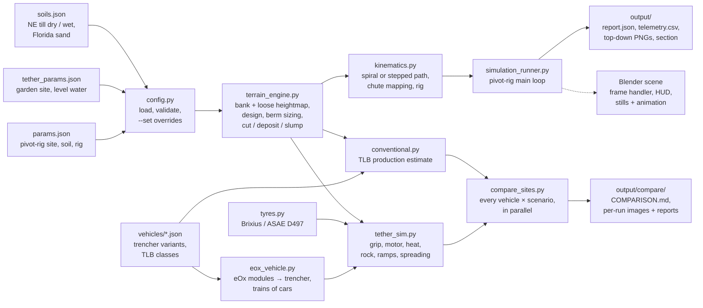

## Quick start

You need Python 3 with NumPy. Blender is optional. Run from `ring_engine/`.

```bash
python3 simulation_runner.py
```

```bash
python3 simulation_runner.py --res 256 --lifts 4 --path stepped --set soil.swell_factor=1.3 --png-every 30
```

```bash
/Applications/Blender.app/Contents/MacOS/Blender --python simulation_runner.py
```

```bash
/Applications/Blender.app/Contents/MacOS/Blender -b --python simulation_runner.py -- --still-frame 150 --render-still out.png
```

```bash
python3 tether_sim.py --soil ne_glacial_till
```

```bash
python3 tether_sim.py --soil florida_sand --site flat --res 320
```

```bash
python3 eox_vehicle.py
```

```bash
python3 conventional.py --soil ne_glacial_till
```

```bash
python3 compare_sites.py
```

- `simulation_runner.py` headless writes `output/`: `report.json`,
  `telemetry.csv`, top-down PNGs and `cross_section.svg/csv`.
- In Blender it builds the scene and bakes the sim; scrub or play the timeline.
  The animation runs from a `frame_change_pre` handler, so a saved `.blend`
  opens frozen on its saved frame. `--render-anim <dir>` renders every frame
  and `--save-blend <path>` saves the scene.
- `tether_sim.py` writes `output/tether/`: report, telemetry, hillshades of
  existing, design, progress and final ground, and the slope section.
  `--vehicle`, `--power battery` and `--set a.b=value` change the run.
- `eox_vehicle.py` lists the trencher variants.
- `conventional.py` prints the TLB estimate for one soil.
- `compare_sites.py` runs every vehicle on every scenario on all cores (about
  30–40 min) and writes `output/compare/COMPARISON.md`. `--only` and `--soils`
  pick a subset.

`output/` is gitignored scratch space. Runs worth keeping are copied into
[`runs/`](runs/) (see [`runs/README.md`](runs/README.md)), and the README's
images are in `docs/img/` (`tools/make_figs.py` redraws the SVGs).

## Repository

| Path | What |
|---|---|
| `ring_engine/params.json` | Pivot-rig site: geometry, soil (Sf, φ, β), rig, speeds, animation |
| `ring_engine/config.py` | Loads and validates parameters, `--set a.b=value` overrides, berm-to-moat pairing |
| `ring_engine/terrain_engine.py` | Heightmap (bank + loose), design profiles, level-water moats, berm sizing, cut / deposit / slump, volumes, PNG output, Blender mesh I/O |
| `ring_engine/kinematics.py` | Spiral or stepped trajectory over the lifts, mass-haul chute mapping, cycle time, Blender rig |
| `ring_engine/simulation_runner.py` | Pivot-rig main loop, telemetry, report, headless outputs, Blender scene, HUD and frame handler |
| `ring_engine/tether_params.json` | Garden-scale site: 2 moats, 2 berms, level water, 6 ft slope |
| `ring_engine/soils.json` | Soil presets: swell, repose, density, cutting energy, cone index, water table, boulder refusals |
| `ring_engine/tyres.py` | Tyre grip and rolling resistance, ported from eOx `src/eox/tyres.py` |
| `ring_engine/eox_vehicle.py`, `vehicles/` | Trenchers built from eOx modules; trains of cars; the TLB classes |
| `ring_engine/tether_sim.py` | Tethered-trencher sim |
| `ring_engine/conventional.py` | TLB construction baseline |
| `ring_engine/compare_sites.py` | Vehicle × scenario sweep and comparison table |
| `docs/img/` | README figures and renders (SVGs in light + dark) |

## Status and open work

- **The homestead, built simply:** [docs/simple-build.md](docs/simple-build.md)
  lays out the home-farm version (island with three buildings, fish ring with
  winter holes, orchard and pasture berms, a floating work spoke) and how to
  build it with the fewest things that can break. Its numbers come from
  `tools/homestead_numbers.py`.
- **Energy:** [docs/energy.md](docs/energy.md) sizes the solar panels, solar
  thermal, ground-source heat pump and pond or trench loops.
- **Investment and return:** [docs/economics.md](docs/economics.md) treats the
  homestead as a product, with surplus soil and stone sold, gravel and sand
  bought, and payback, NPV and builder margin.
- **Greenhouses:** [docs/greenhouse.md](docs/greenhouse.md) puts 24×72 ft
  high tunnels on the pasture berm. Four, sized to the direct market, make the
  homestead pay even without a fill market.
- **Where it makes sense:** [docs/where-it-pays.md](docs/where-it-pays.md)
  sweeps the drivers. A homeowner needs two of three things: a fill market,
  direct-sale produce, or land-value uplift. A builder profits almost anywhere
  the fill has somewhere to go.

Planning is on the shared
[GitHub Project](https://github.com/users/zacharyelston/projects/7), with
[eOx](https://github.com/zacharyelston/EOx). eOx supplies the drive-axle
module, the 3 HP unit, the 48 V bus limits and the tyre model.

- **Kept runs:** every run behind the figures and tables above is kept in
  [`runs/`](runs/), with an index of how each was made.
- **Soil data:** every soil value is a handbook estimate. Test pits and a
  cone-penetrometer reading on a real site would calibrate them.
- **Fan-cooled motors:** the 1.4× continuous-torque figure is assumed and
  needs a bench motor test.
- **Multi-axle chassis:** a fixed 4WD or 6WD frame scrubs its tyres on a
  circle. An articulated frame locked to the ring's curvature avoids that
  ([eOx issue 5](https://github.com/zacharyelston/EOx/issues/5)).
- **Grip in sand:** Brixius is fitted to agricultural soils and is optimistic
  in loose sand, so treat the Florida eOx figures as a best case.
