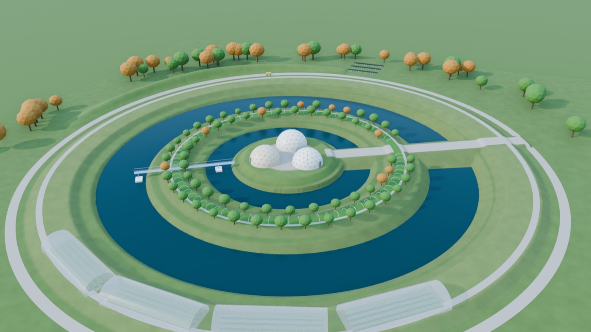
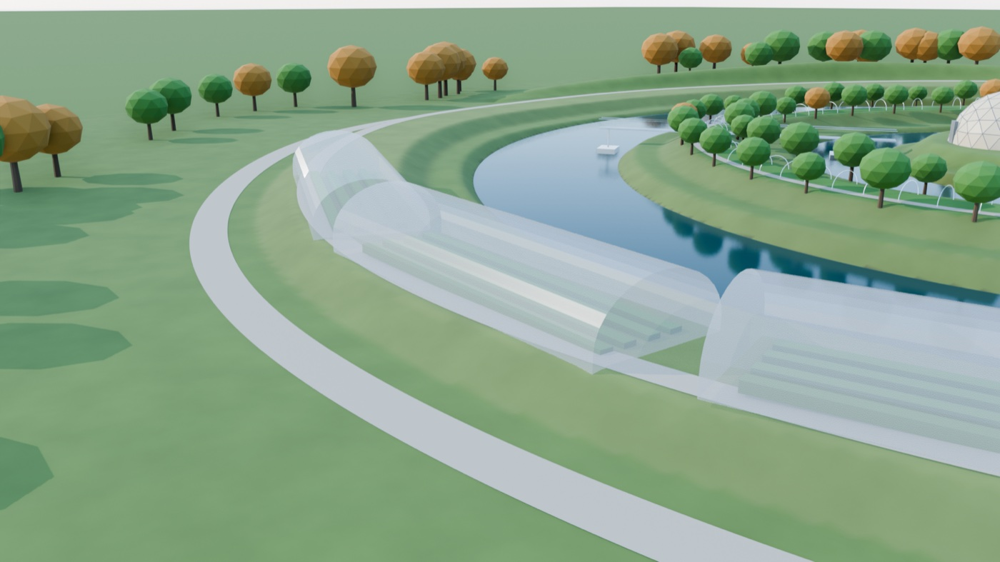

# High tunnels on the pasture berm

Covering part of the second (pasture) berm with high tunnels gives the
homestead a longer growing season and a vegetable business sized to what a
family can sell. This page covers what fits, what each tunnel grows and earns,
whether to heat one, and how many to build.

Numbers come from `tools/greenhouse_budget.py` (it writes
`docs/greenhouse_budget.json`). The tunnels are folded into the homestead's
payback and NPV through `GREENHOUSE` in `tools/homestead_economics.py` and
the grid in `tools/economics_explore.py`. **These are screening figures**,
from New England extension surveys and enterprise budgets, not a crop plan.

*Rendered from the design by `tools/render_homestead.py --tunnels 4`.*

---

## The short answer

- **Four 24×72 ft tunnels is the sweet spot:** about 6,900 ft² under cover,
  on the south arc of the pasture berm.
  - **What it adds:** with typical yields, hired labour and direct sales,
    about $21k a year net to the homestead.
  - **What it does to the NPV:** on the flat New England site, with fill at
    $8/yd³, the 25-year NPV goes from −$56k to +$207k, with a 7-year payback.
- **Size the tunnels to your direct market, not to the berm.** The berm takes
  17 tunnels (29,400 ft²). Beyond about four, the produce outgrows what one
  homestead can sell direct, and the rest has to go wholesale. With hired
  labour, wholesale tunnel crops lose money. Eight tunnels earn less than four.
- **Leave them unheated, or heat one.**
  - **Unheated:** a New England tunnel adds about 16 weeks of harvest over
    open ground: tomatoes 4 weeks earlier and later, then winter greens under
    row cover.
  - **Frost-free:** heating one for winter greens adds about $2.7k a year
    net. It needs about 15,000 kWh of heat (5,000 kWh of electricity through
    the heat pump, or 10 more solar panels).
- **New England gains more than Florida.** Season extension is worth most
  where the open season is short. Florida's tunnels are for rain and pest
  protection in its winter growing season, and are hot in summer.

---

## What fits on the berm

| | |
|---|---|
| Pasture berm flat top | 8.84 m wide, centred on a 69 m radius ring |
| Tunnel | 24 × 72 ft (7.3 × 21.9 m) gothic arch, roll-up sides, drip irrigation |
| Bow of a straight tunnel on the curve | 0.87 m, so it needs 8.19 m: **fits** |
| 30 × 96 ft (the common commercial size) | needs 10.7 m: **doesn't fit** |
| Spacing | 3 m between tunnels, plus a gap at the causeway |
| Whole ring | up to 17 tunnels, 29,400 ft² (2,700 m²) |

- **The south arc first.** There the ring runs east–west, which is the best
  orientation for winter light. The renders place the first four there.
- **One tunnel gets the full NRCS cost-share.** 24×72 ft is 1,728 ft², under
  the 2,178 ft² that EQIP's high-tunnel practice pays for per producer.
- **The goats keep the rest of the berm.** They also have the outer border,
  and they must stay out of the tunnels.

---

## One tunnel for a year, New England

| Case | Revenue | Net a year | Net $/ft² | Capex | Payback |
|---|---|---|---|---|---|
| Unheated, typical yield, wholesale | $11.5k | **−$0.9k** | −$0.50 | $8.6k | never |
| Unheated, typical yield, sold direct | $20.9k | **$5.4k** | $3.15 | $8.6k | 1.6 y |
| Unheated, top-grower yield, direct | $30.6k | $13.6k | $7.88 | $8.6k | 0.6 y |
| Frost-free, top-grower yield, direct | $35.6k | $16.4k | $9.47 | $21.2k (incl. 10 panels) | 1.3 y |
| Unheated, top-grower yield, direct, family labour | $30.6k | $24.5k | $14.18 | $8.6k | 0.4 y |

The table assumes hired labour at $18/h unless marked. The first tunnel's
EQIP cost-share (about $6.5k) is applied only in the farm and homestead
totals.

**What goes in:**
- **Tomatoes, typical:** 1.78 lb/ft² of marketable tomatoes, the average
  across 47 New England tunnel growers in a University of Vermont survey.
- **Tomatoes, top growers:** 3 lb/ft². The best growers in that survey
  passed 5 lb/ft².
- **Tomato prices:** $4.56/lb retail (the survey average) and about $2.50/lb
  wholesale.
- **Winter greens:** about $3/ft² unheated, after the tomatoes. That figure
  comes from a secondary source, so check it. Frost-free adds about 97 % (the
  late-kale result from SARE trial FNC21-1277).
- **Spring greens:** about $1/ft², before the tomatoes go in.
- **Costs:**
  - inputs $1/ft² a year, less 25 % because ring water feeds the drip lines;
  - about 600 hours of labour a tunnel (0.35 h/ft²);
  - 15 % of direct sales for selling (stand, market fees, packaging);
  - upkeep at 2 % of capex a year;
  - $5/ft² installed (basic tunnels run $3–6/ft²).

The typical direct case nets $3.15/ft². That lines up with Iowa
cherry-tomato tunnels, which reported $1.14–2.64/ft² net.

---

## How many tunnels

New England, top-grower yields, sold direct up to $80k a year (a farm stand,
a CSA and a few restaurants); anything beyond is sold wholesale. Hired labour,
the first tunnel cost-shared.

| Tunnels | Floor | Revenue | Sold wholesale | Net a year | Net capex | Labour |
|---|---|---|---|---|---|---|
| 2 | 3,456 ft² | $61k | – | $27k | $11k | 1,200 h (0.6 worker) |
| **4 (1 frost-free)** | 6,912 ft² | $106k | $26k | **$43k** | $41k | 2,400 h (1.2) |
| 8 (2 frost-free) | 13,824 ft² | $176k | $96k | $62k | $88k | 4,800 h (2.4) |
| 17 (2 frost-free) | 29,376 ft² | $327k | $247k | $101k | $166k | 10,300 h (5.1) |

- **Net grows much more slowly than the tunnels past four.** Each tunnel past
  the direct-sale limit adds about $4–5k a year, against about $11k for each
  of the first four, while the labour keeps growing in step.
- **The whole ring is a vegetable business**, not a homestead: five workers
  and a wholesale buyer. It's an option for a builder or a farm business, not
  the default.

## What it does to the homestead

25-year homeowner NPV with typical yields, hired labour and direct sales
(`tools/economics_explore.py`, greenhouse grid):

| Tunnels | Fill price | NE 6 ft slope | NE flat | Florida |
|---|---|---|---|---|
| 0 | $0 | −$197k | −$126k | −$78k |
| 0 | $8 | −$60k | −$56k | −$37k |
| 2 | $8 | +$83k | +$86k | +$5k |
| **4** | **$0** | **+$66k** | **+$137k** | −$1k |
| **4** | **$8** | **+$203k** | **+$207k** | +$40k |
| 8 | $8 | +$119k | +$123k | −$118k |

**Four tunnels make the New England homestead pay even with no fill market at
all.** That makes them the strongest single lever found so far, stronger than
the fill market, direct sales of the other produce, or land value.

---

## Heating: one tunnel, from the deep ring

- **The heat load:** a double-poly tunnel loses about 0.75 BTU/hr per ft² of
  cover per °F. Kept above 40 °F through a Hartford winter (about 1,500 °F·days
  below 40 °F, less a third for daytime sun), that's about **15,000 kWh of heat
  a year**.
- **The heat pump:** the ground-source heat pump supplies it at COP 3, about
  5,000 kWh of electricity, or 10 more panels on the north border.
- **The loop:** a frost-free tunnel's heat comes from the berm-core loop or the
  deep ring. That's about 10,000 kWh taken from the ring each winter, equal to
  about 2.6 cm of ice over it, so one or two heated tunnels are fine.
- **Avoid 55–60 °F winter tomatoes in New England.** That setpoint needs several
  times the heat, and the fuel cost of heated hoop houses is the problem
  Vermont growers report.

## What to watch

- **Snow and wind:** the berm crown is exposed. Choose gothic, snow-rated bows
  with ground-post anchors, and keep the plastic tight.
- **Plastic:** greenhouse poly lasts about 4–5 years. Its replacement is in
  the inputs line.
- **Labour:** about 600 hours a tunnel a year, peaking in July–September. It's
  the real limit for a family.
- **Selling:** direct sales take time and a place to sell. The $80k cap is the
  key assumption; your local market sets it.
- **Water:** ring water through the drip lines carries fish nutrients, but
  test it and keep it off leaf crops before harvest.

## Sources

- New England tunnel tomatoes, 1.78 lb/ft² average, $4.56/lb retail, about
  $23k gross a tunnel:
  [Growing Produce: high-tunnel tomatoes](https://www.growingproduce.com/?p=179028),
  [New England Vegetable & Fruit Conference: Tweaking Tomato Tunnels](https://newenglandvfc.org/wp-content/uploads/2026/05/Tweaking-TomatoTunnels.pdf)
- Iowa tunnel net income, $1.14–2.64/ft²:
  [Practical Farmers of Iowa, cherry tomato budget](https://practicalfarmers.org/wp-content/uploads/2018/11/17.H.Enterprise_Budget_Cherry_Tomatoes.pdf),
  [Blue Gate Farms](https://practicalfarmers.org/wp-content/uploads/2019/01/Blue-Gate-Farms-High-Tunnels-Take-2-2009.pdf)
- Crop choice and revenue: [University of Kentucky](https://ccd.uky.edu/news/choosing-high-tunnel-crops-revenue-basics)
- Tunnel cost, $3–6/ft², and EQIP, $3.76/ft² up to 2,178 ft²:
  [Rutgers, high tunnel investment decisions](https://farmmgmt.rutgers.edu/high-tunnel-investment-decisions/),
  [NRCS high tunnels](https://www.nrcs.usda.gov/sites/default/files/2023-12/High%20Tunnels%20%28Hmong%20and%20English%29.pdf)
- Winter heat and row covers, 97 % more late kale heated:
  [SARE FNC21-1277](https://projects.sare.org/project-reports/fnc21-1277/);
  winter production: [UMass Extension](https://www.umass.edu/agriculture-food-environment/vegetable/special-topics/winter-production-storage/production)
- Heating Vermont greenhouses:
  [UVM biomass heating report](https://www.uvm.edu/vtvegandberry/Pubs/BiomassHeatingVermontGreenhouses2015Report.pdf),
  [SARE LNE10-299](https://projects.sare.org/sare_project/lne10-299/?ar=2011)
- Not checked here, and worth confirming locally: winter-greens prices and
  yields, labour hours (track your own), your state's current EQIP rate, and
  your direct-market size.
