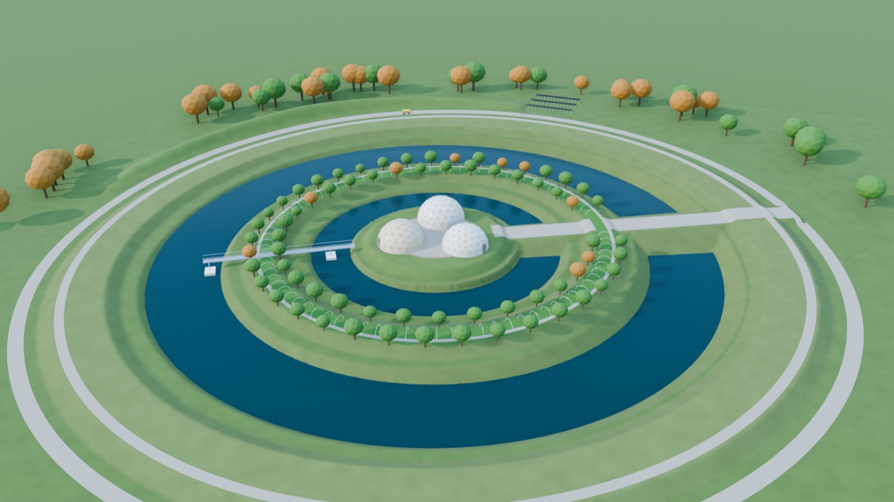
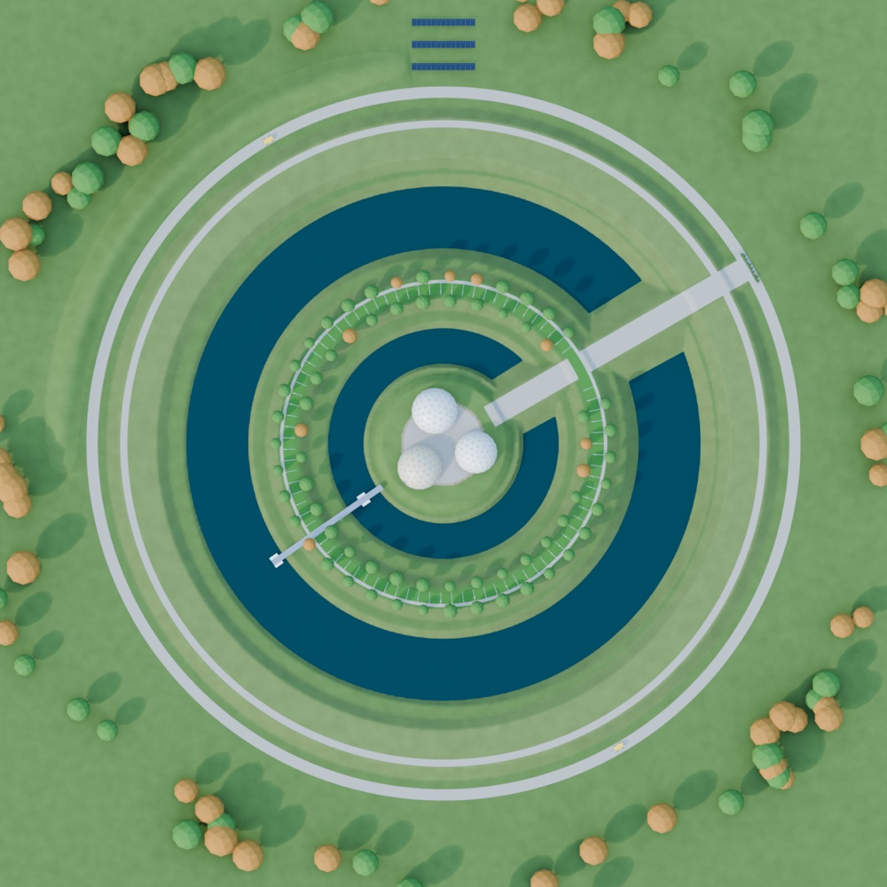

# Building the Atlantean homestead simply

The Atlantean site is a home farm, not an earthworks demo. A family lives on
the centre island in three buildings around a shared courtyard: a house, a barn
for goats and ducks, and a workshop for tools and an eOx. Around the island,
water rings alternate with planted berms. Fruit trees on the berms lean out
over the water, ducks work the shallow inner ring, the larger fish live in the
deep outer ring, and goats graze the outer berm. A pivot arm floats on the
water to tend, pick and clean. The rings freeze in winter, when nothing is
growing, so the arm simply parks. Energy (solar, heat pumps, ground loops) is
in [energy.md](energy.md).

This document is about building that with as few things as possible that can
break. The numbers come from `tools/homestead_numbers.py` and
`ring_engine/homestead_params.json` on the same terrain engine as the rest of
the repo. They are screening estimates: handbook soil values, assumed hire
rates, and a synthetic site.

*Rendered from the design by `tools/render_homestead.py`, with the relief
exaggerated 1.5×.*

It has old precedents. The Pearl River Delta's dike-pond farms grew mulberry
on embankments between fish ponds, fed the leaves to silkworms and the
silkworm droppings to the fish, then dug the pond mud back onto the dikes. FAO
gives dike-to-water area ratios of 1:1, and 4:6 or 3:7 where other feed is
brought in. The Aztec chinampas were planted islands between canals. The
Atlantean version adds a circle, so one pivot can reach everything.

---

## Ten rules for simple and robust

1. **Dig ponds; don't build dams.** Every waterline sits below the lowest
   existing ground around its ring, so no embankment ever holds water back.
   There is nothing to breach or seep, and the site usually stays outside
   dam-safety rules. The terrain engine already designs it this way (level
   water, 0.3 m freeboard).
2. **Let rain fill it, and make the spillway the main structure.** In New
   England the rain on the site is about five times what the rings hold. The
   water problem is overflow, not supply.
3. **Shallow inside, deep outside.**
   - **The inner ring:** 0.9 m deep and next to the courtyard. It's cheap,
     easy to plant and wade, and the one to warm.
   - **The outer ring:** 8 ft deep. Its greater length gives the larger fish
     several times the water, a winter refuge under the ice, and a bed for the
     ground-source loop.
   - **The cheaper option:** a 6 ft outer ring saves about a quarter of the
     digging. Two 10 ft winter holes in it then give the fish their refuge.
4. **Berms are growing land, not spoil heaps.** Build them low (0.9 m) with
   wide flat tops and 3:1 sides you can mow, walk and plant.
5. **Spoil is a product.** Raise the house island up to a metre, for dry
   floors and flood safety.
   - **With a buyer:** sell the rest as fill and screened fieldstone. Against keeping
     it on site, a fill market cuts the earthworks bill by $40–200k depending
     on the site ([economics.md](economics.md)).
   - **Without one:** build a bund on the uphill side that turns outside
     runoff away from the rings.
6. **Strip the topsoil first and put it back on the berms.** Subsoil and till
   don't grow much. Topsoil is the berms' real crop, and it is free if you
   keep it.
7. **Hire the pond crew once.** An excavator and a small dozer are what New
   England pond builders use. They do the job in weeks, not seasons (see
   [the numbers](#the-numbers)). eOx machines maintain the site afterwards.
8. **Motors on land, floats in water.** Nothing powered goes in the water.
   The arm floats on off-the-shelf dock floats and is turned from the island
   end.
9. **Work with the seasons.** Ice is fine: the arm comes ashore in autumn and
   the ducks winter in the barn. Fish winter in the deep holes.
10. **Every stage is useful on its own.** Ponds and berms first, then trees,
    animals and buildings. Add the arm only when tending from a boat gets old.

The New England till turns up about 550 boulders. Those are not waste. They
armour the spillway, line the ring edges, and build steps and dry-stone
walls.

---

## The layout

<!-- radii in ring_engine/homestead_params.json; daylight gaps are 4 m because
     the banks reach further on the high side of a sloped site -->

| Ring | Radius | What it is |
|---|---|---|
| Island | 0–18 m | Three buildings around a courtyard, raised up to 1 m with spoil. The arm turns from a bearing at the island edge. |
| Inner ring | 18–26 m | 0.9 m deep: emergent plants, summer rafts of greens, ducks. A 100 m² greenhouse bay beside the courtyard can be kept warm ([energy.md](energy.md)). |
| Orchard berm | 30–40 m | 0.9 m high, with a 4.9 m flat top. Fruit trees on both edges lean over both rings. |
| Deep ring | 44–58 m | 8 ft deep (2.44 m), with a safety shelf at the edge and 2:1 banks below it. A third of its bed is deeper than 8 ft. It holds the larger fish, their winter refuge and the pond loop. |
| Pasture berm | 62–76 m | 0.9 m high, with an 8.8 m flat top, for goats. Four 24×72 ft high tunnels on its south arc ([greenhouse.md](greenhouse.md)). The ring takes up to 17. |
| Outer land | beyond 76 m | The north border holds the solar array, on the south face of a windbreak bund made from surplus spoil. |

The whole site is **152 m across (1.81 ha, 4.5 acres)**. A causeway crosses
both rings on the uphill side, with a culvert beneath it, so trucks reach the
island.

**Why these sizes.**
- **The island:** three buildings about 10 m across around a courtyard about
  10 m across need an island of about 18 m radius.
- **The gaps:** on a slope, a level-water moat's banks reach further out on
  the high side, so the rings and berms sit 4 m apart. The design check in
  `terrain_engine.py` refuses a layout where they would run into a berm.
- **The deep ring:** at 1.1 acres of water, with about 0.35 acre deeper than
  8 ft, it meets the usual pond-loop rule of at least half an acre and
  8–10 ft of depth.

---

## The numbers

From `tools/homestead_numbers.py`, which writes `docs/homestead_numbers.json`.

| | NE till, 6 ft slope | NE till, flat | Florida sand, flat |
|---|---|---|---|
| **Recommended: 8 ft outer ring** | | | |
| Bank cut | 14,225 m³ | 9,663 m³ | 9,663 m³ |
| Deepest dig | 4.07 m | 2.74 m | 2.74 m |
| Spoil the berms can't take | 14,062 m³ | 7,674 m³ | 4,969 m³ |
| **Pond crew (excavator + dozer)** | **51 days, $155k** | **34 days, $106k** | **20 days, $64k** |
| Backhoe loader (~90 hp) | 257 days, $385k | 175 days, $262k | 100 days, $153k |
| **Cheaper: 6 ft outer ring** | | | |
| Bank cut | 11,112 m³ | 7,111 m³ | 7,111 m³ |
| Pond crew | 40 days, $121k | 25 days, $78k | 14 days, $45k |
| **Either layout** | | | |
| Water held (8 ft / 6 ft ring) | 7,900 / 5,600 m³ | same | same |
| Rain on the site per year | 21,800 m³ | 21,800 m³ | 24,500 m³ |
| Evaporation from the rings | 3,600 m³ | 3,600 m³ | 7,300 m³ |

8 h working days. Cost is hire with operators, fuel, delivery and a pump.
These are screening rates; get local quotes.

- **Pick the flattest ground you have.** On the 6 ft slope, the deep outer ring
  costs about $50k more than on flat ground, and doubles the surplus spoil. The
  outer ring is long, so it crosses more of the slope, and its high side has to
  be cut to 4 m to hold level water.
- **The pond crew beats any tractor loader-backhoe.** It is about 5× faster and
  2.5× cheaper than the backhoe loader. The compact TLB can't reach the bed of
  an 8 ft ring at all.
- **Surplus spoil:**
  - **Where it goes:** it raises the island by up to 1 m, then becomes a
    windbreak bund along the north and northwest border. That shelters the
    island from winter winds and gives the solar array a south-facing slope.
  - **How much:** on flat ground that's about a 3 m bund roughly 170 m long.
    On the slope it's twice that.
  - **The alternative:** clean fill can also be given away. Haulers often take
    it for free.
- **Two layouts that didn't work:**
  - **Spoil-sized berms:** sizing the berms to take all the spoil, the way the
    earlier sims do, left them as ridges with flat tops only 0.5–0.7 m wide.
  - **The deep ring inside:** putting it inside is cheaper (8,871 m³ on the
    slope), but gives the fish half the water and puts the coldest ring next to
    the house.

## Water: rain, spillway, winter

- **New England: always overflowing.** About 21,800 m³ of rain falls on the
  site each year. The rings hold 7,900 m³ and lose about 3,600 m³ to
  evaporation.
  - The rings never need pumping or topping up.
  - A 100-year, 24-hour storm (about 7.5 in in southern New England) puts
    about 3,400 m³ on the site in a day. The spillway has to pass that without
    washing out.
- **The spillway: wide, shallow and stone-lined, at the low side.**
  - Build it as a grassed channel through undisturbed ground, armoured with
    the boulders from the dig.
  - Avoid pipes and risers as the main outlet: they clog, and that is how
    small ponds fail.
  - The inner ring overflows into the deep ring over a stone weir. The deep
    ring overflows off site through the spillway.
- **Florida: groundwater-fed.** With the water table about 0.9 m down, the
  rings fill from below and their level follows the water table. They need no
  seal, and the level drops in the dry season.
- **The uphill bund keeps outside water out.** On a slope, runoff from the
  land above the site would flow straight into the rings with its silt. The
  bund sends it around.
- **Winter: ice is fine, winterkill is the risk.**
  - Fish die over winter when long ice and snow cover cut off light and air,
    and shallow, weedy ponds are worst.
  - The 8 ft outer ring is the refuge (or the winter holes, in a 6 ft ring).
  - Penn State Extension's advice is to keep about 30 % of the ice clear of
    lasting snow, so light still reaches the plants that make oxygen. With
    holes this deep, a small aerator is optional.
- **NRCS reference depths.** Ohio's pond standard asks 8 ft for excavated
  ponds (6 ft if spring-fed). Colorado asks 10 ft over a third of the area for
  cold-water ponds. The 8 ft outer ring meets the Ohio figure, with about a
  third of its bed at full depth. The inner ring is shallow on purpose.

---

## Soil and sealing

- **New England till usually holds water.** It is clay-rich and dense.
  - The risk is a lens of sand or gravel crossing a ring.
  - Dig 3–4 test pits to 10 ft before anything else, and look for them.
  - If one turns up, cut it out and line that stretch with compacted till
    from elsewhere on site.
- **Compaction.** Place berm and island fill in 6–8 in lifts and track each
  one in with the dozer. It settles less, erodes less, and grows better than
  loose dumped spoil.
- **Seed straight away.** Bare till washes into the rings at the first storm.
  Respread topsoil, seed and mulch each section within days of shaping it.

---

## Buildings on the island

- **Three buildings, one courtyard.** House, barn and workshop face inward;
  the courtyard is the yard, the work area and the arm's base.
- **Choose structures with few seams.**
  - **Geodesic panel domes** look right, but every panel joint is a possible
    leak, and windows and finishes are awkward.
  - **Simpler round choices:** a monolithic concrete or earth-sheltered dome
    for the house, and steel arch (Quonset-type) or hoop buildings for the
    barn and workshop. They are kit-built and snow-shedding, with few joints.
  - Choose deliberately: the house is the one place leaks matter most.
- **Septic and well setbacks are the biggest design risk.**
  - States set minimum distances from a septic field to surface water,
    commonly 50–100 ft. Check yours.
  - An island surrounded by water may have no room for one.
  - The simple answers are composting toilets, or a septic field and a well
    outside the rings, downhill and uphill respectively.
- **Build the causeway and island pad first.** Concrete and delivery trucks
  need a solid road onto the island before the rings are dug around it.

---

## The farm loop

| Part | What lives there | What it gives | Care |
|---|---|---|---|
| Deep ring | New England: largemouth bass, channel catfish, yellow perch, bluegill. Florida: catfish, bass, bluegill. | Fish; nutrient-rich water; the ground loop's heat source | Stock after the first summer of water, once plankton has established. Check state stocking rules. Keep pond-loop coils away from the deepest refuge. |
| Warm bay (optional) | Tilapia and greens in a 100 m² greenhouse bay of the inner ring | Year-round fish and greens | Needs heat ([energy.md](energy.md)). Tilapia must not escape into open water; check state rules. |
| Orchard berm | Mulberry, persimmon, apples, pears on the water edges | Fruit; dropped fruit feeds the fish | Keep goats out: they strip bark. |
| Inner ring | Watercress, pickerelweed, cattail at the edges; floating rafts of greens in summer; ducks | Greens; filtering | Ducks winter in the barn. Ice lets foxes cross. |
| Pasture berm | Goats on rotational paddocks | Milk, meat, brush control | Keep manure back from the water's edge, with a grassed buffer. |
| Pond mud | Dredged from the rings every few years | Fertiliser for the berms | The dike-pond loop. |

- **Aquaponics without tanks.** The ring is the fish tank and the biofilter.
  One small solar pump lifts ring water to drip lines on the orchard berm, and
  it drains back. If the pump stops, nothing dies.
- **The water is a predator barrier.** Foxes and coyotes don't swim to the
  ducks' island in summer. In winter the ice bridges it, so the ducks come in.

---

## The work arm, simply

Each stage is useful on its own. Stop at the stage that does the job.

1. **A boat.** A flat-bottomed punt or kayak, with a rope ring in each ring:
   feeding, picking overhanging fruit, netting.
2. **A floating spoke.** A walkway from a pivot bearing at the island edge out
   to the deep ring.
   - It sits on one dock float (HDPE cubes or drums) in the inner ring and one
     in the deep ring.
   - Over the orchard berm it's a light 24 m truss, which is also a trellis
     for vines.
   - You walk out and pick from the trees on both edges.
   - You push it round by hand, on a rope.
3. **A powered spoke.** The same spoke, turned by one eOx 3 HP unit on the
   island, winding a cable laid around the inner ring like a capstan.
   - The motor and the bus stay on the island, and nothing powered floats.
   - **It sweeps 340° and back** instead of turning full circle, so it never
     meets the causeway. Its cable hangs free, and it needs no slip ring.
   - Tools hang from it: picking trays, a skimmer, later a small suction
     dredge for pond mud.
   - Two small flat panels on it can power its own controls. Don't load it
     with the main solar array: 22 panels would put about 77 kN on a floating
     walkway in a design gust ([energy.md](energy.md)).
4. **Winter.** Swing the spoke to the island and lift the floats out, or leave
   them frozen in on purpose. Nothing needs to run until spring.

---

## Build sequence

| When | What |
|---|---|
| Year 0, winter | Choose the flattest spot. Survey it (drone or phone). Dig 3–4 test pits to 10 ft. Talk to the NRCS field office (free pond design help) and the town about wetlands, building and septic permits. |
| Year 1, July–October | Pond crew for about 10 weeks (New England, sloped), 7 weeks (New England, flat) or 4 weeks (Florida): <ol><li>Strip and stockpile topsoil.</li><li>Build the causeway.</li><li>Lay the ground-loop trench in the orchard berm core.</li><li>Dig the rings.</li><li>Raise the island pad and the berms in compacted lifts.</li><li>Armour the spillway and the weir.</li><li>Shape the bund.</li><li>Respread topsoil, then seed and mulch.</li></ol> |
| Year 1, winter | The rings fill with rain and snowmelt. |
| Year 2, spring | Plant the orchard berm and the ring edges. Bring the ducks. Fence the pasture. |
| Year 2 | Buildings on the island. Stock fish once the water has had a summer. Bring the goats. |
| Later | The floating spoke, once tending by boat gets old. The eOx for mowing, hauling, mud and regrading. |

---

## How this changes the simulations

- **New layout:** `ring_engine/homestead_params.json` has a shallow inner
  ring, an 8 ft outer ring, and berms at a set height
  (`balance.auto_size_berms: false`) instead of sized to take all the spoil.
- **New numbers script:** `tools/homestead_numbers.py` reports water held,
  deep-water area, flat crown width, spoil surplus, the water balance, and
  build days and cost for each machine. It covers each layout tried and each
  soil.
- **Energy:** `tools/energy_budget.py` sizes the PV, solar thermal, heat pump
  and loops ([energy.md](energy.md)).
- **New baseline machine:** the pond crew (`excavator_dozer` in
  `vehicles/conventional_machines.json`). It digs and pushes at the same time,
  so the job takes the longer task; both machines are paid for.
- **Not modelled yet:**
  - the winter holes as real shapes (they are added as volume only);
  - the causeway;
  - the island raise and the bund as terrain;
  - the spillway, storms and water levels over a year;
  - loads and floats for the spoke.

## Sources

- FAO, dike-pond farming and dike-to-water ratios:
  [fao.org/4/ac241e](https://www.fao.org/4/ac241e/ac241e00.htm),
  [fao.org/4/y1187e](https://www.fao.org/4/y1187e/y1187e09.htm)
- NRCS Conservation Practice Standard 378 (Pond), state versions:
  [Ohio 2018](https://efotg.sc.egov.usda.gov/api/CPSFile/20854/378_OH_CPS_Pond_2018),
  [Colorado 2016](https://efotg.sc.egov.usda.gov/api/CPSFile/3352/378_CO_CPS_Pond_2016),
  [North Carolina 2017](https://efotg.sc.egov.usda.gov/api/CPSFile/23057/378_NC_CPS_Pond_2017),
  [national 2022](https://www.Nrcs.Usda.Gov/sites/default/files/2022-09/Pond_378_NHCP_CPS_2022.pdf)
- Penn State Extension, winterkill in ponds:
  [extension.psu.edu/winterkill-in-ponds](https://extension.psu.edu/winterkill-in-ponds)
- Not separately checked here, and worth confirming locally: the 100-year
  storm depth, septic setbacks, state fish-stocking rules and hire rates.
