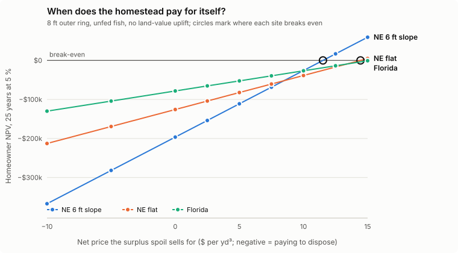
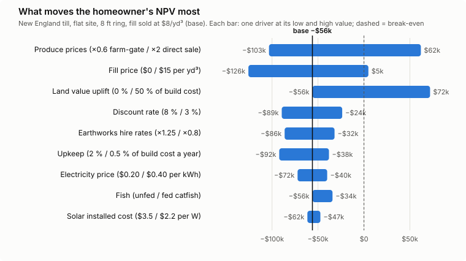
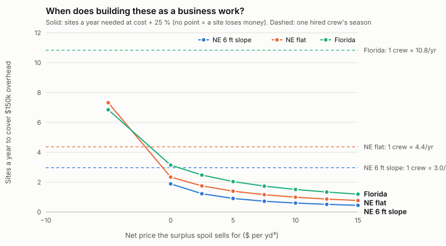

# Where the Atlantean homestead makes sense

This page explores [economics.md](economics.md): it varies the drivers that
move the answer and finds the break-even points, from two sides:
- **The homeowner:** does a family building one for itself come out ahead?
- **The builder:** does selling them as a design-build product work as a
  business?

Numbers come from `tools/economics_explore.py`, which writes
`docs/economics_explore.json` and the charts. The layout is the recommended
one (shallow inner ring, 8 ft outer ring). Every base price is in
`tools/homestead_economics.py`. **These are screening estimates** from vendor
and extension prices, not quotes, and the buildings and land are left out.

---

## The short answer

- **Four high tunnels on the pasture berm beat every other lever.** With
  typical yields, hired labour and direct sales, they move the New England
  homestead's NPV from −$56k to about +$205k with fill at $8/yd³, and to
  +$66–137k with no fill market at all. See [greenhouse.md](greenhouse.md).
  The levers below are for a homestead without tunnels.
- **For a homeowner, any two of three things make it pay:**
  1. **a fill market:** the surplus spoil sells for about $8/yd³ or more,
     with the buyer hauling it;
  2. **direct sales:** produce sold through a farm stand, CSA or restaurants
     at about 2× farm-gate prices;
  3. **land value:** about 25 % or more of the build cost shows up in the
     property's value.

  With only one of them it mostly doesn't, and with none it loses
  $80–200k over 25 years.
- **For a builder, it works almost anywhere there's a fill market.** Every
  site is profitable even when the spoil is given away ($48–80k a site at cost
  + 25 %). With fill at $8/yd³, one or two sites a year cover $150k of
  overhead, and one hired pond crew can dig 3–11 a year.
- **The best place is a New England hillside with a fill market nearby.** It
  makes the most spoil and stone to sell, and the builder's profit grows with
  the slope. Without a market, the same hillside is the worst site.
- **Florida suits a homestead that sells direct.** It's the cheapest to dig
  and has the longest digging season (about 11 sites a year per crew). It has
  the least spoil to sell, so it pays through produce, not soil.

---

## Homeowner: the fill price sets the starting point

<picture>
  <source media="(prefers-color-scheme: dark)" srcset="img/econ-npv-vs-fill-dark.svg">
  
</picture>

| Fill price (net, $/yd³) | NE 6 ft slope | NE flat | Florida |
|---|---|---|---|
| −10 (pay to dispose) | −$367k | −$213k | −$130k |
| 0 (give away) | −$197k | −$126k | −$78k |
| 5 | −$111k | −$82k | −$52k |
| 10 | −$26k | −$39k | −$27k |
| 15 | +$59k | +$5k | −$1k |
| **Break-even fill price** | **$11.5** ($9.1 if screened for stone) | **$14.4** ($12.2 screened) | about $15 |
| Land value needed to break even at $7.5 fill | 22 % of build cost | 24 % | 21 % |

These figures assume farm-gate produce, unfed fish and no land-value uplift.
Slope makes the line steeper: the sloped site has the most to lose without a
market and the most to gain with one.

---

## What moves the answer most

<picture>
  <source media="(prefers-color-scheme: dark)" srcset="img/econ-tornado-dark.svg">
  
</picture>

The base case is New England till on a flat site, with fill at $8/yd³ and an
NPV of −$56k.

| Driver (low / high) | NPV low | NPV high | Swing |
|---|---|---|---|
| Produce prices: ×0.6 farm-gate / ×2 direct sale | −$103k | **+$62k** | $165k |
| Fill price: $0 / $15 per yd³ | −$126k | +$5k | $131k |
| Land value uplift: 0 % / 50 % of build cost | −$56k | **+$72k** | $128k |
| Discount rate: 8 % / 3 % | −$89k | −$24k | $65k |
| Earthworks hire rates: ×1.25 / ×0.8 | −$86k | −$32k | $54k |
| Upkeep: 2 % / 0.5 % of build cost a year | −$92k | −$38k | $54k |
| Electricity price: $0.20 / $0.40 per kWh | −$72k | −$40k | $32k |
| Fish: unfed / fed catfish | −$56k | −$34k | $22k |
| Solar installed cost: $3.5 / $2.2 per W | −$62k | −$47k | $15k |

- **The farm business matters more than the earthworks.** Selling direct
  instead of at the farm gate is the biggest single lever. The homestead's
  yearly products (fruit, eggs, goats, greens, fish) are worth twice as much
  sold to people instead of wholesalers.
- **Only three drivers cross break-even on their own:** produce prices, the
  fill market and land value. Cheaper hire rates, solar or upkeep help, but
  none of them flips the answer alone.

## The three big levers together

Homeowner NPV, 25 years at 5 %:

| Fill | Produce | Land uplift | NE 6 ft slope | NE flat | Florida |
|---|---|---|---|---|---|
| $0 | farm-gate | 0 % | −$197k | −$126k | −$78k |
| $0 | farm-gate | 25 % | −$117k | −$62k | −$31k |
| $0 | direct sale | 0 % | −$78k | −$8k | **+$40k** |
| $0 | direct sale | 25 % | +$1k | **+$56k** | **+$87k** |
| $8 | farm-gate | 0 % | −$60k | −$56k | −$37k |
| $8 | farm-gate | 25 % | +$19k | +$8k | +$11k |
| $8 | direct sale | 0 % | **+$58k** | **+$62k** | **+$81k** |
| $8 | direct sale | 25 % | **+$138k** | **+$126k** | **+$129k** |
| $15 | farm-gate | 0 % | +$59k | +$5k | −$1k |
| $15 | direct sale | 25 % | **+$257k** | **+$187k** | **+$165k** |

---

## Builder: is there a business in it?

<picture>
  <source media="(prefers-color-scheme: dark)" srcset="img/econ-builder-dark.svg">
  
</picture>

The design-build price is the build cost plus 25 %. The builder keeps the
soil and stone returns and carries $150k a year of overhead (design, project
management, office, insurance, marketing). Crews are hired per job, as in the
cost model.

| Site | Crew days per site | Sites per crew per season | Profit per site at $0 / $7.5 / $10 fill | Sites a year to cover overhead at $0 / $7.5 fill |
|---|---|---|---|---|
| NE 6 ft slope | 51 | 3.0 (150-day season) | $80k / $207k / $250k | 1.9 / 0.7 |
| NE flat | 34 | 4.4 | $64k / $129k / $151k | 2.3 / 1.2 |
| Florida | 20 | 10.8 (220-day season) | $48k / $86k / $99k | 3.1 / 1.7 |

- **Every site makes money if the spoil can be given away free.** Paying to
  dispose of it ($10/yd³) turns every site into a loss. The first thing to
  find is somewhere for the fill to go.
- **New England: fewer, bigger jobs.** A sloped site takes most of a season,
  and a fill market makes each one worth $200k+.
- **Florida: more, smaller jobs.** Short builds and a year-round season let
  one crew do about 11 a year. Each makes less, so volume and direct-selling
  buyers matter.
- **Owning equipment is the next question.** At 3+ sites a year, owning the
  excavator and dozer instead of hiring the crew likely cuts the earthworks
  cost. This model doesn't test that yet.

---

## Slope: a penalty without a market, a bonus with one

New England till, 8 ft outer ring; the same site with more fall across it:

| Relief | Bank cut | Surplus spoil | Homeowner NPV, fill $0 | Homeowner NPV, fill $8 | Builder profit, fill $0 | Builder profit, fill $8 |
|---|---|---|---|---|---|---|
| 0 ft | 9,664 m³ | 7,676 m³ | −$126k | −$56k | $64k | $134k |
| 2 ft | 11,069 m³ | 9,643 m³ | −$148k | −$57k | $69k | $159k |
| 4 ft | 12,590 m³ | 11,772 m³ | −$171k | −$59k | $74k | $187k |
| 6 ft | 14,227 m³ | 14,065 m³ | −$197k | −$60k | $80k | $216k |
| 7 ft | 15,091 m³ | 15,274 m³ | −$210k | −$61k | $82k | $232k |
| 8 ft and more | the layout doesn't fit | | | | | |

- **With a fill market,** each extra foot of slope adds about $14k of builder
  profit, and the homeowner hardly notices.
- **Without one,** each foot costs the homeowner about $12k.
- **Above about 7 ft of fall across the site,** the deep ring's banks reach
  into the berms on the high side. Steeper sites need wider gaps (a bigger
  site) or terraced rings at different water levels. Neither is modelled yet.

---

## What this means for the product

- **Sell the homestead as a working farm.** The direct-sale channel (farm
  stand, CSA, restaurants, agritourism) is worth more than any engineering
  saving. It belongs in the product as a planned business, not left as a
  hope.
- **Line up the fill market before each dig.** It's the difference between
  $80k and $200k+ of builder profit on a New England site.
- **Get land value counted.** An appraisal before and after on early sites
  would show whether 25 % of the build cost really shows up in the property.
  If it does, a homeowner can finance the build against it.
- **Lead with New England hillsides near growing towns.** Fill sells there,
  and the stone has a market.

## Not in the model yet

- the buildings and the land;
- labour for running the farm, and the costs of direct selling (stand,
  market time, licences);
- owning equipment instead of hiring it;
- financing;
- property tax on the improved land;
- the value of resilience (food, water, energy at home);
- terraced layouts for slopes over 7 ft;
- more than one homestead size.
